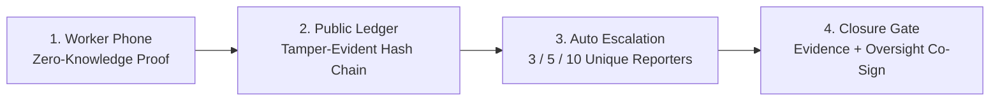

# FairShift 🛡️

> **Anonymous worker safety reporting with zero-knowledge membership proofs, a tamper-evident public ledger, and real-time AI voice agents.**  
> *Built for UN SDG 8: Decent Work, Safe Workplaces, and Whistleblower Protection.*

---

## The Problem in Plain English

When workers witness life-threatening hazards—exposed high-voltage lines, faulty scaffolding, chemical leaks, or blocked emergency exits—they face an impossible choice:
1. **Report it and risk retaliation:** Lose their job, lose shifts, or get blacklisted.
2. **Use an internal "anonymous" form:** Where the employer can quietly edit, close, or delete the complaint and pretend it never happened.

**FairShift makes cover-ups mathematically impossible and protects whistleblowers with zero-knowledge cryptography.**

---

## How FairShift Works (The 4 Pillars)



### 1. Zero-Knowledge Identity (Semaphore v4 / Groth16)
- **Mathematical Privacy:** The worker's phone builds a Groth16 proof locally in their browser. It proves: *"I am a verified employee registered at this job site,"* **without revealing who they are**.
- **No Identity Column:** The server never receives a name, badge number, or employee ID. Even if the database is leaked, worker identities do not exist on the server.
- **Sybil Resistance (1 Worker = 1 Voice):** Each worker's secret generates a unique *nullifier* per hazard. If 5 reports are filed, it is mathematically guaranteed to be **5 distinct human beings**, preventing spam and fake inflation.

### 2. Tamper-Proof Public Ledger (Append-Only Hash Chain)
- **No Delete Button:** The ledger is an append-only hash chain signed by Ed25519 cryptographic keys (`system`, `admin`, and `oversight`).
- **Independent Browser Verification:** Any auditor, journalist, or judge can open `/ledger` to recompute every SHA-256 hash, verify signatures, and validate Groth16 proofs directly in their browser.

### 3. Automatic Escalation & Deadlines
As more unique coworkers report a hazard, or if management delays fixing it, the issue escalates automatically:
- **1–2 Workers:** Tier 1 — Site Supervisor (72h SLA)
- **3–4 Workers:** Tier 2 — Site Manager (48h SLA)
- **5–9 Workers:** Tier 3 — Regional Safety Lead (24h SLA)
- **10+ Workers:** Tier 4 — Public Board & Independent Oversight (12h SLA)

*Missing an SLA deadline generates a permanent, indelible `ESCALATION_RAISED` record on the public ledger.*

### 4. The Closure Gate (No Quiet "Mark as Resolved")
Employers cannot simply click a button to dismiss an issue. An issue has only two valid exits:
1. **Signed Fix Resolution:** Concrete repair actions with a cryptographic SHA-256 evidence hash.
2. **Hashed Disciplinary Action:** Formal accountability with hashed subject references (never raw names).
3. **Independent Oversight Signature:** High and Critical severity issues require a second, independent key (`OVERSIGHT_ATTESTED`) from a safety inspector before the closure event can exist.

---

## 🎙️ Dual Voice AI Agents (OpenRouter Gemma 4 31B + Web Speech)

FairShift integrates browser-native Web Speech recognition and text-to-speech with **Google Gemma 4 31B** on OpenRouter:

- **Worker Voice Assistant (`/worker`):**
  - Designed for hands-busy, on-site workers wearing gloves or with low literacy.
  - Workers simply click **"Speak"** or chat conversationally.
  - The AI classifies the hazard category, determines the site zone, and composes an auditable description ready for one-click ZK sealing.
  - Supports **English, Hindi (हिन्दी), and Tamil (தமிழ்)**.
- **Admin Voice Desk (`/admin`):**
  - Allows safety directors to operate hands-free: speak commands like *"Show critical hazards"*, *"Filter structural risks"*, or *"Read pending closures"*.

---

## Tech Stack

| Layer | Technology |
|---|---|
| **Frontend** | Next.js 16 (App Router), React 19, TypeScript, Tailwind CSS v4 |
| **Zero-Knowledge** | Semaphore Protocol v4, Groth16 over BN254, SnarkJS |
| **Cryptography** | Node Crypto, `@noble/curves` (Ed25519), `@noble/hashes`, AES-256-GCM |
| **Voice & AI** | Web Speech API (STT/TTS) + OpenRouter API (**Gemma 4 31B**) |
| **Testing** | Vitest 5.0, tsx |
| **Deployment** | Vercel (Edge UI) + Standalone Container (VPS / Cloud Run) |

---

## Quickstart (Run Locally in 2 Minutes)

```bash
# 1. Clone repository
git clone https://github.com/shripad-jyothinath/fairshift.git
cd fairshift

# 2. Install dependencies & download ZK circuit artifacts
npm install
npm run setup:zk

# 3. Configure AI Voice Agent (Optional - OpenRouter)
echo "OPENROUTER_API_KEY=your_key_here" >> .env.local

# 4. Start local development server
npm run dev
```

Open [http://localhost:3000](http://localhost:3000) in your browser.

---

## Default Portals & Roles

| Portal | URL | Credentials | Purpose |
|---|---|---|---|
| **Worker Portal** | `/worker` | Verified Employee Badges | File anonymous zero-knowledge safety reports with AI voice assistance |
| **Employer Desk** | `/admin` | Passphrase: `fairshift-demo` | Triage hazards, review evidence, publish fixes, voice dashboard controls |
| **Independent Oversight** | `/admin` | Passphrase: `fairshift-oversight` | Co-signs closure for High & Critical severity issues |
| **Public Ledger** | `/ledger` | *Public Access (No login)* | Cryptographically verifies hash chain, Merkle anchors, and ZK proofs |

---

## Running Automated Tests

```bash
npm test
```

Covers:
- **Hash Chain Integrity:** Genesis linking, payload tampering detection, broken chain rejection.
- **Ed25519 Signatures:** Sign/verify across `system`, `admin`, and `oversight` actors.
- **Zero-Knowledge Proofs:** Real Groth16 verification, scope binding, nullifier uniqueness.
- **Closure Gate Logic:** Missing evidence, missing oversight sign-off, invalid exit types.
- **Privacy & Redaction:** Auto-redaction of phone numbers, emails, government IDs, and URLs.
